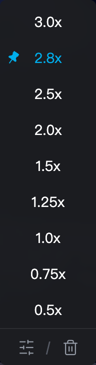

# 超好用B站倍速助手

非官方桌面浏览器扩展，在 B 站原生倍速菜单内补充 **2.5 / 3 倍**，支持滑动选择 **0.25–10 倍**。

[源码仓库](https://github.com/whuyfk/bili-suisu) · [下载发行包](https://github.com/whuyfk/bili-suisu/releases) · [反馈问题](https://github.com/whuyfk/bili-suisu/issues) · [隐私政策](PRIVACY.md) · [MIT License](LICENSE)

当前源码版本：**1.9.5**。临时倍速仅用于当前视频及其分 P，切到其他视频时恢复 1 倍；点击图钉后才会跨视频使用固定速度。支持长按右箭头临时加速、松手恢复。

支持普通视频、合集/分 P、播放列表、番剧，以及网页全屏和全屏。采用浏览器原生音视频倍速处理。未固定时，临时速度只在当前视频及其分 P 内保留；站内切到另一个视频、列表条目或番剧集恢复 1 倍。刷新或新开页面遵循 B 站自身初始设置。固定后，新视频和刷新会使用图钉指定的默认速度。

无服务器、无广告、无数据收集。仅使用浏览器本地扩展存储保存用户添加的快捷倍速和主动固定的默认速度，不保存观看记录，也不自动保存临时改速。日常操作都在播放器的原生倍速菜单中完成，无需打开独立弹窗。

## 本地安装

### Chrome / Edge

1. 从 [Releases](https://github.com/whuyfk/bili-suisu/releases) 下载对应的 Chrome / Edge ZIP 并解压；从源码安装则先按下文构建，使用 `dist/chromium`。
2. 打开 `chrome://extensions` 或 `edge://extensions`，启用“开发者模式”。
3. 点击“加载已解压的扩展程序”，选择**包含 manifest.json 的文件夹**。
4. 刷新已打开的 B 站播放页面，将鼠标移到播放器的倍速按钮上。

本地开发者安装不等同于商店安装。正式公开发行应使用商店审核通过后的页面。

### Firefox

1. 打开 `about:debugging#/runtime/this-firefox`。
2. 点击“临时载入附加组件”，选择 `dist/firefox/manifest.json`，或先解压 Firefox ZIP 后选择其中的文件。
3. 刷新 B 站播放页面。

临时安装会在 Firefox 关闭后移除；普通用户的正式安装需要 Mozilla 签名或从 Firefox Add-ons 商店安装。Releases 中的 Firefox ZIP 未经 Mozilla 签名，可用于上述临时安装。

最低声明版本：Chrome / Edge 120，Firefox 142。移动浏览器、直播、嵌入第三方网站的播放器和 B 站客户端不属于首版范围。

## 使用

- 点击任意倍速选项立即生效并收起菜单；原有选项仍由 B 站处理。
- 点击「自定义」，用鼠标点击滑轨或拖动滑块选择 0.25–10 倍，面板实时显示待选值；点击“确定”或按 Enter 应用，成功后自动关闭。
- 拖动期间保留当前播放速度，确认后才改变；方向键切换相邻档位，Home / End 跳到最小 / 最大值。除最低 0.25 倍外，滑块按 0.1 倍步进。B 站原有的 1.25 / 0.75 倍选项仍然可用，打开自定义时预选最近档位，不立即改变播放速度。
- 自定义面板在鼠标移出后自动关闭，未确认的滑块草稿不会应用或保存；拖动时保持展开，移出并松手后关闭；“取消”放弃未应用的播放速度草稿并返回倍速列表；已经收藏的快捷项会保留；Escape、点击外部或焦点离开会放弃草稿并关闭。
- 选好速度后点击数字右侧空心星标，立即保存快捷项，星标变为粉色实心；再次点击取消收藏。固定档位已在列表中，无需收藏。收藏不应用播放速度，也不会关闭面板；点击“确定”应用，或“取消”返回列表。
- 悬停或用键盘聚焦自定义快捷项时显示右侧“×”，点击可删除该项；列表底部垃圾桶图标（悬停提示“清空”）移除用户保存的快捷项及图钉固定值，保留 B 站原生档位和扩展固定的 2.5 / 3 倍档位。
- 快捷项仅保存在本机 `storage.local` 中，不跨设备同步；不会写入 B 站的 localStorage 或 Cookie。
- 悬停倍速行时左侧显示图钉，已固定的图钉保持显示，点击即应用该速度并固定为所有新视频的默认倍速，蓝色实心表示已固定；再点解除固定。固定期间临时选其他速度只影响当前视频，下个视频仍用固定值。
- 自定义面板只保留滑块和收藏星标，不显示图钉。先收藏自定义速度，返回原倍速栏，再悬停该行点击图钉即可应用并固定。
- 删除或取消收藏被固定的自定义速度，或点击“清空”，会同时解除固定，当前播放速度保持不变。没有自定义快捷项但存在固定值时也显示清空图标；清空后斜线和垃圾桶一起隐藏，滑杆图标居中。
- 长按右箭头：小于 3 倍时临时 3 倍；大于等于 3 倍时临时乘以 1.5，上限 10 倍。松开恢复原速，如 `3 → 4.5 → 3`、`4.1 → 6.15 → 4.1`、`7 → 10 → 7`；短按仍由 B 站前进约 5 秒，编辑滑块或文本时不启用。该规则针对右箭头，原生鼠标长按不改写。
- 未固定时，暂停、拖动进度、清晰度切换、同一视频分 P 和播放器重建保留临时速度；右侧推荐、跨视频自动连播、列表换条目及番剧换集回到 1 倍。刷新或新开页面后，插件不主动恢复旧临时速度，遵循 B 站自身初始行为。

底栏的滑杆图标悬停提示“自定义”，点击打开滑块面板；垃圾桶图标悬停提示“清空”，点击清空快捷项及固定默认值。

界面预览：[单图标底栏](docs/screenshots/menu-footer-single.png) · [双图标底栏](docs/screenshots/menu-footer-pair.png) · [倍速列表](docs/screenshots/menu-compact.png) · [自定义编辑](docs/screenshots/custom-editor.png) · [已收藏](docs/screenshots/custom-editor-saved.png)

## 界面预览

| 原生倍速菜单 | 自定义与收藏 |
| --- | --- |
|  |  |

## 开发与构建

需要 Node.js 22.18+（建议使用 Node.js 24）、npm，以及打包用的 `zip` 命令。

```sh
git clone https://github.com/whuyfk/bili-suisu.git
cd bili-suisu
npm ci
npm run build
```

`dist/chromium` 用于 Chrome 和 Edge，`dist/firefox` 用于 Firefox。运行时代码无第三方依赖；构建工具和测试依赖只用于开发。

```sh
npm run typecheck
npm run test:unit
npx playwright install firefox
npm run test:browser
npm run lint:firefox
npm run package
```

浏览器测试默认需要已安装桌面 Chrome 和 Edge，以及 Playwright Firefox。`npm run check` 执行类型、单元、构建、Firefox 清单和全部浏览器检查。真实 B 站联网测试另用 `npm run test:live`，取消固定专项使用 `npm run test:live:unpin`（真实 BPX 菜单与跨页导航，复用媒体生命周期使用模拟事件），`npm run test:live:navigation` 分别检查从未固定的原生 0.5 / 增强 2.5 / 自定义 7 倍、取消图钉与清空后的右侧推荐、刷新、番剧及自然播放结束后的自动连播，还核对同一视频分 P 的临时倍速保留，不合成媒体生命周期事件；长按专项使用 `npm run test:live:fast-forward`（三浏览器真实普通视频 / 番剧及原生键盘操作）。`npm run test:live:menu` 检查实际网页全屏、鼠标和键盘菜单操作，并显式模拟窗口失焦与旧焦点恢复；不等同于完整的操作系统桌面焦点测试。网络限制或 B 站改版可能导致失败，应检查输出而非跳过失败。

`npm run package` 会在 `release/` 生成三个浏览器 ZIP、可复现构建的源码 ZIP 和 SHA-256 校验文件。Chrome 和 Edge 使用相同的运行时代码，但保留各自文件名，便于分别提交。

## 代码与维护

- `src/adapter.ts`：当前 BPX 播放器结构适配；普通视频与番剧的结构已在真实网页核对。
- `src/presets.ts`：快捷倍速和固定默认值的本地保存、删除、清空及标签页同步，每个档位单独存储以避免同时添加互相覆盖。
- `src/fast-forward.ts`：识别原生长按提示、临时加速与松手有界恢复，隔离输入编辑和视频切换。
- `src/media.ts`：真实倍速读写和有限次数的生命周期恢复；不持续锁定倍速。
- `src/menu.ts`：菜单插入、去重、滑块预览与提交、键盘隔离和实际速度显示。
- `src/content.ts`：页面路由、播放器发现、局部观察和资源释放。
- `tests/fixtures/`：模拟播放器和自行生成的测试音视频，用于可重复回归；不是商店截图。

播放器重建、开始加载及媒体就绪时执行有限恢复，每轮最多在 0 / 100 / 400 / 1000 ms 恢复四次。首个 playing 后不再因普通暂停 / 继续重启恢复；用户原生操作会取消本轮及剩余就绪恢复。播放器的临时快进不会被持续抢回。B 站未来更改播放器 DOM 时，需更新适配器并重新验证。

测试证据见 [测试记录](docs/TESTING.md)，商店提交流程和文案见 [发布说明](docs/PUBLISHING.md)，数据处理见 [隐私政策](PRIVACY.md)。

本扩展与哔哩哔哩无隶属、授权或合作关系。MIT License。
